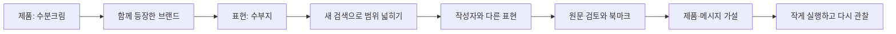

# Aialy Contents Watcher

**좋은 제품을 만드는 회사가, 시장의 언어도 배울 수 있도록.**

Instagram 콘텐츠를 모아 브랜드·제품·소비자 표현을 연결하고, 발견한 근거를 제품 개발과 마케팅 실험에 활용하는 독립 웹앱입니다. 마케팅 전담자가 없는 제조사도 작은 조사부터 시작할 수 있도록 만들고 있습니다.

> 이 문서의 ‘수분크림 → 비교 브랜드 A → 수부지 → 탄력탱탱’은 **사용법을 설명하는 가상 탐색 사례**입니다. 실제 분석 결과나 특정 브랜드의 활동에 대한 주장이 아닙니다. 현재 검색·집계 범위는 **연결해 수집한 게시물**이며, Instagram 전체를 검색하는 기능은 아직 연결되지 않았습니다.

## 처음이라면: 많이 모으기보다 질문 하나부터

‘요즘 뭐가 유행하지?’는 너무 넓습니다. 오늘 확인할 질문을 한 문장으로 바꿔 보세요.

| 궁금한 것 | 시작할 질문 | 결과로 남길 것 |
| --- | --- | --- |
| 우리 브랜드의 외부 반응 | 프레쥬를 누가, 어떤 제품·표현과 함께 언급했을까? | 원문 링크와 작성자, 제품명, 맥락 |
| 경쟁 브랜드의 활동 | 비슷한 수분크림을 어떤 고민과 연결해 소개할까? | 브랜드별 메시지·형식·반응 비교 |
| 신제품의 기회 | 수부지 사람들이 함께 이야기하는 다른 고민은 뭘까? | 추가로 검증할 고객 문제 가설 |
| 협업할 크리에이터 | 이 고민을 꾸준히 다루는 사람은 누구일까? | 관련 게시물 근거와 후보 목록 |
| 메시지 개선 | 성분 설명과 사용감 설명 중 어떤 방식이 눈에 띌까? | 직접 시험할 콘텐츠 아이디어 |

게시물 수와 좋아요를 많이 모으는 것이 목적은 아닙니다. **어떤 사람이, 어떤 상황에서, 어떤 말로 제품을 이해하는지** 알아내는 것이 목적입니다.

## 1. 조사 공간을 나누세요

왼쪽 위 워크스페이스를 눌러 새 공간을 만들거나 전환합니다. 브랜드명뿐 아니라 카테고리, 국가, 조사 목적 등 원하는 이름을 쓸 수 있습니다.

| 워크스페이스 예시 | 처음 등록할 대상 | 첫 질문 예시 |
| --- | --- | --- |
| 스킨케어 | 자사 스킨케어 계정, 비교 브랜드, 피부 고민을 다루는 크리에이터 | 수분크림이 어떤 피부 고민과 연결되는가? |
| 바디케어 | 바디워시·바디로션 브랜드와 관련 크리에이터 | 향, 보습, 등드름 중 무엇을 강조하는가? |
| 헤어케어 | 샴푸·트리트먼트 브랜드와 헤어 크리에이터 | 두피 고민과 모발 손상이 어떻게 표현되는가? |
| Fraijour 글로벌 | 직접 등록한 해외 운영 계정과 현지 참고 계정 | 국가별로 같은 제품을 어떻게 소개하는가? |

각 공간의 연결 정보, 수집 대상과 콘텐츠, 추적 조건, 브랜드 사전, 광고 자료, 북마크는 분리됩니다. 새 공간은 비어 있으며 기존 자료를 자동으로 복사하지 않습니다. 같은 계정을 여러 공간에 등록할 수 있지만 공간마다 별도로 수집합니다. 기존 자료는 기본 `Fraijour` 공간에 보존됩니다. 현재 워크스페이스는 **개인 앱 안의 조사 구분**이며, 사용자 초대나 팀별 접근 권한 기능은 아닙니다.

처음에는 공간을 너무 잘게 나누지 마세요. ‘스킨케어’ 한 곳에서 시작하고 자료와 질문이 늘어나면 나누어도 됩니다. 바이어가 운영하는 계정은 직접 소유한 자사 계정과 혼동하지 않도록 이름에 운영 주체를 적어 두세요. 공개 프로페셔널 계정의 공개 게시물 수집과 비공개 계정 인사이트에 대한 권한은 별개입니다.

## 2. 제품에서 시작해, 소비자의 표현으로 이동하세요

아래 흐름은 정답을 찾는 검색이 아니라 **다음 질문을 발견하는 조사**입니다.



1. **제품 키워드로 출발합니다.** 소셜 게시물에서 `수분크림`을 검색합니다. 조사 기간과 수집 계정을 확인하고, 결과가 어떤 표본인지 먼저 파악합니다.
2. **함께 등장한 브랜드를 봅니다.** 예를 들어 비교 브랜드 A이 눈에 띄었다면 해당 브랜드로 좁혀 봅니다. 브랜드 사전에 이름과 별칭을 등록하면 `REFERENCE A`, `비교 브랜드 A` 같은 표현을 함께 묶을 수 있습니다. 본문에 브랜드가 등장했다는 뜻이지 그 브랜드가 직접 게시했다는 뜻은 아닙니다.
3. **반복되는 표현을 찾습니다.** 관련 게시물에서 `수부지`가 반복되면 원문을 열어 어떤 문맥인지 읽습니다. ‘수부지에 좋다’와 ‘수부지에는 안 맞는다’는 단어가 같아도 의미가 다릅니다.
4. **새 검색으로 넓힙니다.** `수부지`를 새 검색으로 열어 다른 브랜드와 작성자에게도 나타나는지 봅니다. 기존 비교 브랜드 A 필터를 그대로 유지하면 그 브랜드 안의 표현만 보게 됩니다. 탐색 경로를 이용하면 이전 조건으로 돌아갈 수 있습니다.
5. **사람을 따라갑니다.** 관심 작성자가 자주 사용하는 다른 표현을 확인합니다. 가령 `탄력탱탱`이 보이면 ‘유분 부담 없이 탄력 있는 사용감을 원하는가?’라는 질문을 세웁니다. 단어 하나를 바로 신제품 수요로 해석하지 않습니다.
6. **근거를 저장합니다.** 북마크 보드에 원문과 메모를 남기고, 관찰한 사실과 자신의 해석을 구분합니다.

검색 결과가 적다면 먼저 **수집 범위가 부족한지** 확인하세요. 수집한 자료에 없다는 사실은 시장에 없다는 뜻이 아닙니다. 현재는 관심 계정을 직접 추가해야 탐색 범위가 넓어집니다.

## 3. ‘많이 보인다’와 ‘트렌드다’를 구분하세요

| 확인할 신호 | 왜 확인하나요? | 함께 확인할 것 |
| --- | --- | --- |
| 독립된 작성자 수 | 한 계정의 반복 게시가 유행처럼 보일 수 있습니다. | 다른 계정에도 같은 맥락이 있는가? |
| 기간별 변화 | 게시물 누적량만으로 최근 관심을 알 수 없습니다. | 동일한 기간 길이와 비슷한 수집 범위인가? |
| 실제 표현의 맥락 | 추출된 단어만으로 호감·불만을 알 수 없습니다. | 원문, 제품 유형, 사용 상황 |
| 광고·협찬 표시 | 집중 집행된 캠페인이 소비자의 자발적 관심처럼 보일 수 있습니다. | 표시가 있는가? 없더라도 비협찬으로 단정하지 않기 |
| 지표의 제공 여부 | 조회·좋아요 등은 플랫폼과 게시물마다 제공 범위가 다릅니다. | ‘미제공’을 0으로 해석하지 않기 |
| 반복 관측 | 하루의 화제는 지속적인 고객 문제와 다를 수 있습니다. | 다음 주에도 다른 사람이 언급하는가? |

처음 발견한 키워드는 **트렌드 후보**로 취급하세요. 앱의 직전 기간 비교와 작성자 수는 검토를 돕는 단서입니다. 새 계정을 대거 추가한 주의 게시물 증가를 시장 수요 증가로 해석하면 안 됩니다. 이전 기간이 0건이면 증가율을 억지로 만들지 않습니다.

## 4. 추적 조건과 북마크에 역할을 나누세요

- **추적 조건**은 매번 반복할 질문입니다. `fraijour`, `프레쥬`처럼 별칭을 묶거나, 키워드에 필수어·제외어를 추가합니다. 현재는 수집한 자료를 분류하고 다시 찾는 저장 조건입니다.
- **브랜드 멘션 추적**은 자사 게시물을 제외한 외부 언급을 살펴보는 용도입니다. 자사 계정을 정확히 등록해야 구분에 도움이 됩니다.
- **타겟 멘션 추적**은 `수분크림`, `수부지`, `두피 진정`처럼 지속적으로 볼 주제를 관리합니다.
- **북마크**는 판단에 쓸 근거입니다. ‘좋은 영상’ 대신 ‘첫 3초에 피부 고민을 제시하는 방식’처럼 참고 이유를 남깁니다.
- **메타 광고**는 광고 라이브러리에서 확인한 링크와 카피를 수동으로 저장·비교합니다. 광고가 오래 보인다는 사실만으로 매출이나 수익성이 좋다고 단정하지 않습니다. 자동 수집·상태 갱신은 아직 없습니다.

북마크 메모는 아래처럼 짧게 작성하면 회의에서 재사용하기 쉽습니다.

```text
관찰: 이 게시물은 성분명보다 사용 후 끈적임을 먼저 설명한다.
근거: 원문 링크 / 작성자 / 게시일 / 확인한 문장
해석: 여름철 사용감 불편을 줄여 준다는 메시지가 중요할 수 있다.
다음 행동: 우리 제품 콘텐츠에서 사용감 설명을 먼저 제시하는 안을 시험한다.
미확인: 같은 방식이 다른 작성자·제품에서도 반복되는지는 추가 확인한다.
```

## 5. 첫 주 운영법: 조사 결과를 행동 하나로

| 시점 | 할 일 | 남길 결과 |
| --- | --- | --- |
| 첫날 | 공간 하나, 질문 하나를 정하고 자사·비교 브랜드·크리에이터 계정을 소수 등록 | 조사 대상과 범위 |
| 주중 2~3회 | 수집 갱신 후 제품 → 브랜드 → 표현 → 작성자 순서로 탐색 | 원문을 읽은 근거 3~5개 |
| 주말 또는 주간 회의 | 반복 신호와 반례를 함께 검토 | 이번 주 관찰 한 문장 |
| 다음 주 | 제품 기획 질문 또는 콘텐츠 실험 하나를 실행 | 담당자·실행일·확인할 결과 |

예를 들어 ‘수부지가 뜬다’로 끝내지 말고, **‘수부지 관련 원문에서 끈적임 불편이 반복되는지 확인하고, 확인되면 사용감 중심의 콘텐츠를 소규모로 시험한다’**까지 이어 보세요. 소셜 관찰은 제품 효능의 증명이 아니며 제품 개발 판단에는 실제 고객 인터뷰와 적절한 시험도 필요합니다.

성과는 수집량보다 **발견한 외부 언급, 근거가 있는 가설, 실행한 실험, 다음 판단에 재사용한 자료**로 돌아보는 편이 유용합니다. 매주 작은 질문 하나를 끝내는 습관이 쌓이면 제조 경험과 시장 관찰이 연결됩니다.

---

## 실행

Node.js 24.11 이상이 필요합니다.

```sh
npm install
npm run dev
```

http://127.0.0.1:14316 에서 엽니다. 서버는 로컬 인터페이스에만 바인딩합니다. `PORT`, `DATA_DIR` 환경 변수로 포트와 데이터 위치를 변경할 수 있습니다. 기본 공간 DB는 `.data/instagram.sqlite`, Instagram 인증 파일은 `.data/connection.json`입니다. 공간 목록은 `.data/workspaces.sqlite`, 추가 공간의 자료는 `.data/workspaces/<id>/`에 저장합니다. 인증 파일은 0600으로 저장하고 API 응답에는 토큰을 넣지 않습니다. 현재 구조는 개인 컴퓨터용이며 팀 공유 배포에는 인증·권한·비밀 관리 설계가 추가로 필요합니다.

## 지금 작동하는 범위

- 워크스페이스 추가·전환: 브랜드·카테고리별 데이터와 연결을 분리하고 URL에 선택 공간을 보존합니다.
- 콘텐츠 검색·필터·정렬·상세·비교, 폴더 북마크·메모, 등록 브랜드/크리에이터 계정 허브.
- 소셜 게시물 분석: 기간·OR/AND·브랜드·계정·추적 조건을 목록/집계/CSV에 공통 적용. 언급 추이, 작성자, 제공된 지표 합계, 키워드 후보와 직전 기간 비교.
- 제품 키워드 → 함께 등장한 브랜드 → 관련 표현 → 새 키워드 탐색 → 작성자 계정의 다른 표현으로 이동. 이전 탐색 조건으로 돌아가기.
- 영문·국문 별칭을 묶는 명시적 브랜드 사전. 브랜드 언급은 본문 일치이며 직접 게시·협찬·계약 관계를 추정하지 않습니다.
- 우리 브랜드/타겟 추적 조건의 영속 저장·수정·삭제, 필수어/제외어/계정 조건. 자사 계정을 외부 브랜드 멘션에서 제외.
- 자사 계정 등록과 수집한 게시물 분석. 비공개 인사이트와 계정 평가 점수는 아직 제공하지 않습니다.
- Meta 광고 라이브러리 링크·카피·형식·확인 당시 상태의 **수동** 저장, 검색·필터·최대 4개 비교. 광고 자동 검색·상태 갱신은 미연결입니다.
- Instagram Business Discovery 수집기: 직접 등록한 공개 프로페셔널 계정별 최근 최대 100개, ID 중복 제거, 지표 이력, 실패 시 이전 자료 보존, 계정별 동시 실행 차단, 선택한 계정의 주기 갱신.

## 현재 중요한 한계

**현재는 로컬에서 사용할 수 있는 초기 버전입니다.** 10개 메뉴의 주요 탐색 흐름을 구현했으며, 기능별 제공 범위와 다음 과제는 [구현 현황](docs/implementation-status.md)에 남겼습니다.

2026-10-13 로컬 검증에서 Fraijour 공식 계정(`fraijour_official`)을 연결하고 최근 100개 게시물을 수집했습니다. 두 차례 재수집 후에도 100개의 고유 게시물로 유지됐습니다. 계정의 전체 게시물 수는 515개로 관측되어 과거 자료는 아직 범위 밖입니다. 자동 갱신은 꺼져 있으며, 켜기 전에는 수동 갱신합니다. 테스트 자료는 별도 임시 DB에만 생성합니다.

키워드 추적 조건은 현재 수집한 게시물을 분류하는 조건입니다. 등록하지 않은 인플루언서를 찾아내는 **Instagram 검색 수집 연결은 아직 없습니다.** 일반 본문 전체 검색과 계정 수집은 다른 능력입니다. Meta 앱 생성/읽기 토큰 발급만으로 전 플랫폼 검색이 가능해지지 않습니다.

조회·도달·팔로워·저장·공유 등 제공되지 않은 지표는 만들지 않습니다. 집계는 수집한 일부 자료이며 시장 전체 규모/트렌드의 증명이 아닙니다. 한국어 단어 분리는 초기 후보 추출 수준으로, 동의어·어미·문맥 분석은 향후 보완 대상입니다.

## 검증

```sh
npm run build
npm test
npm run test:e2e
```

E2E는 Chrome을 사용합니다. 기본 경로는 macOS Chrome이며 다른 환경에서는 `CHROME_PATH`를 지정합니다. 테스트 서버는 14317 포트와 별도 임시 DB를 사용합니다. `.research/*fixture*` 화면은 합성 테스트 자료로 실제 인스타그램 증거가 아닙니다.

## 분석 근거와 개발 기준

- [메뉴별 설계 조사와 정적 증거](docs/rea-menu-contracts.md)
- [탐색·트렌드 운영 흐름](docs/exploration-workflows.md)
- [현재 구현과 미구현의 경계](docs/implementation-status.md)
- [REA 실행 증거](docs/rea-evidence.json)

[REA](https://github.com/morluto/rea)는 배포된 공개 JavaScript 구조와 메뉴 사이의 데이터 계약을 분석하는 데 사용했습니다. 원본 공급자·백엔드를 복원하거나 데이터 수집 권한을 제공하는 도구는 아닙니다. 자동 분석 후보는 실제 클라이언트 코드·로그인 화면·공식 가이드를 교차 확인했습니다.
