# 화면으로 배우는 Aialy Contents Watcher

[README로 돌아가기](../README.md) · [Meta 연결 준비](meta-instagram-setup.md)

실제 앱을 **가상 계정 5개와 예시 게시물 20개**로 실행해 촬영했습니다. 모든 계정·제품 그림·광고·수치는 설명용이며 실제 브랜드의 성과나 수집 결과가 아닙니다. 화면은 1440 × 1000 데스크톱 뷰포트이며 아래로 스크롤하면 추가 내용이 이어집니다.

빠르게 둘러보기: [컨텐츠 허브](#discover) · [브랜드 허브](#brands) · [크리에이터 허브](#creators) · [북마크](#bookmarks) · [소셜 게시물](#social) · [메타 광고](#ads) · [추적 관리](#tracking) · [브랜드 멘션 추적](#brand-mentions) · [타겟 멘션 추적](#target-mentions) · [자사 계정 관리](#owned) · [소스 연결](#sources) · [워크스페이스](#workspaces)

<a id="discover"></a>

## 컨텐츠 허브

**언제 쓰나요?** 수분크림 콘텐츠를 한눈에 훑고 참고 후보를 고를 때.

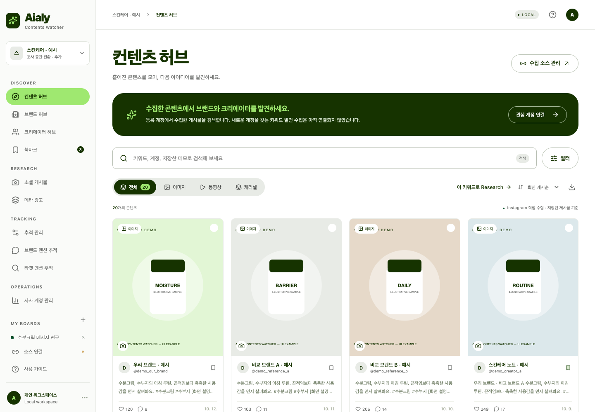

**사용 흐름:** 검색어를 입력하고 콘텐츠 형식·기간·계정을 좁힙니다. 카드를 열어 원문을 보거나 여러 항목을 선택해 비교합니다. 결과를 CSV로 내려받을 수도 있습니다.

**알아두세요:** 현재 연결한 계정의 수집 게시물이 대상입니다. 조회수 등 제공되지 않은 지표는 미제공으로 표시합니다.

<a id="brands"></a>

## 브랜드 허브

**언제 쓰나요?** 비교할 브랜드 계정을 정리할 때.

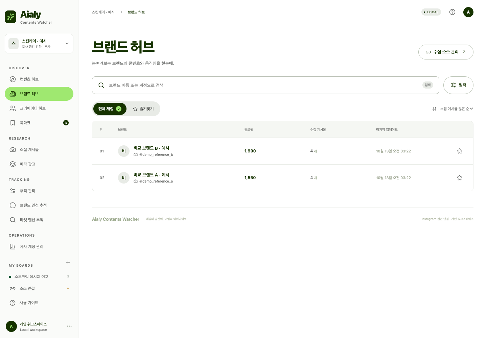

**사용 흐름:** 등록한 브랜드의 프로필과 수집 게시물 수를 확인하고 자주 보는 계정을 즐겨찾기에 넣습니다. 계정의 콘텐츠를 열어 메시지와 형식을 비교합니다.

**알아두세요:** 브랜드를 자동 발굴하는 순위가 아닙니다. 소스 연결에서 등록한 계정이 표시됩니다.

<a id="creators"></a>

## 크리에이터 허브

**언제 쓰나요?** 관심 주제를 다루는 작성자를 꾸준히 살펴볼 때.

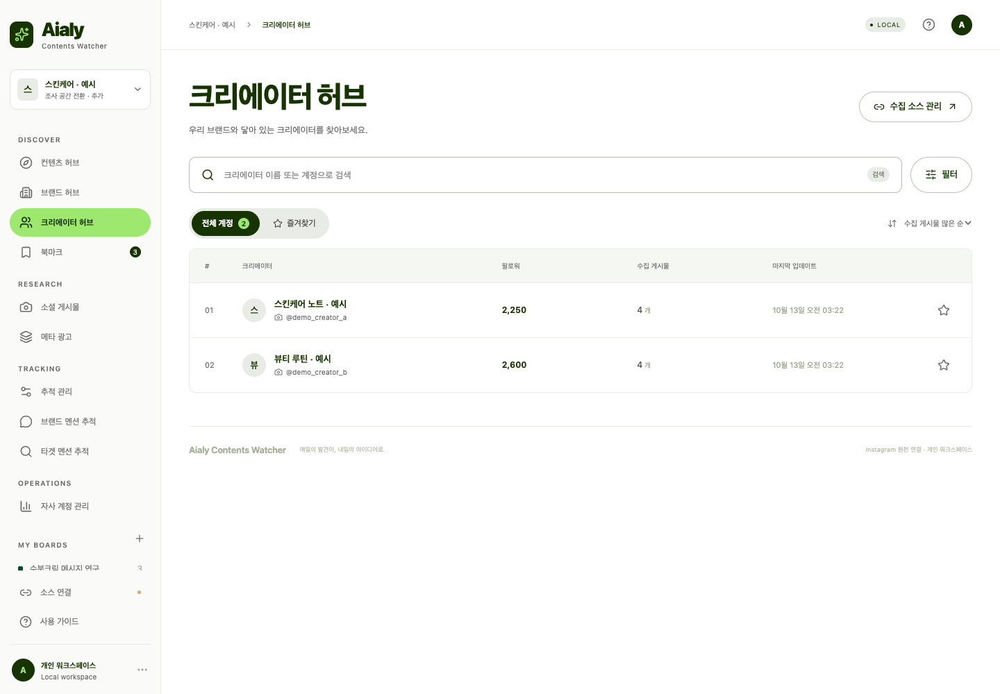

**사용 흐름:** 크리에이터로 등록한 계정의 프로필·게시물과 즐겨찾기를 관리합니다. 소셜 게시물 분석에서 찾은 작성자의 계정을 추가해 조사 범위를 넓힙니다.

**알아두세요:** 연락·협업 계약 관리나 Instagram 전체 인플루언서 검색은 제공하지 않습니다.

<a id="bookmarks"></a>

## 북마크

**언제 쓰나요?** 다음 회의에 쓸 참고 자료를 정리할 때.

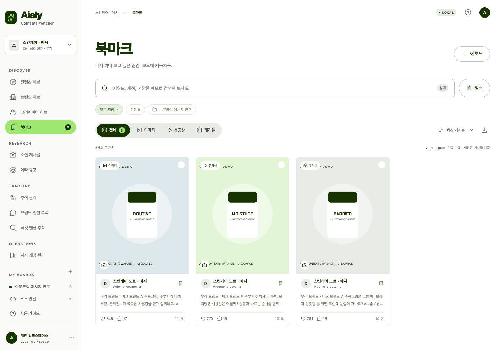

**사용 흐름:** 수분크림 메시지 연구처럼 조사 목적별 보드를 만듭니다. 저장한 콘텐츠를 보드별로 다시 보고 상세 화면에서 메모를 고칩니다.

**알아두세요:** 보드는 현재 워크스페이스 안에서 관리합니다. 다른 공간으로 자동 복사되지 않습니다.

### 상세 화면에서 근거 남기기

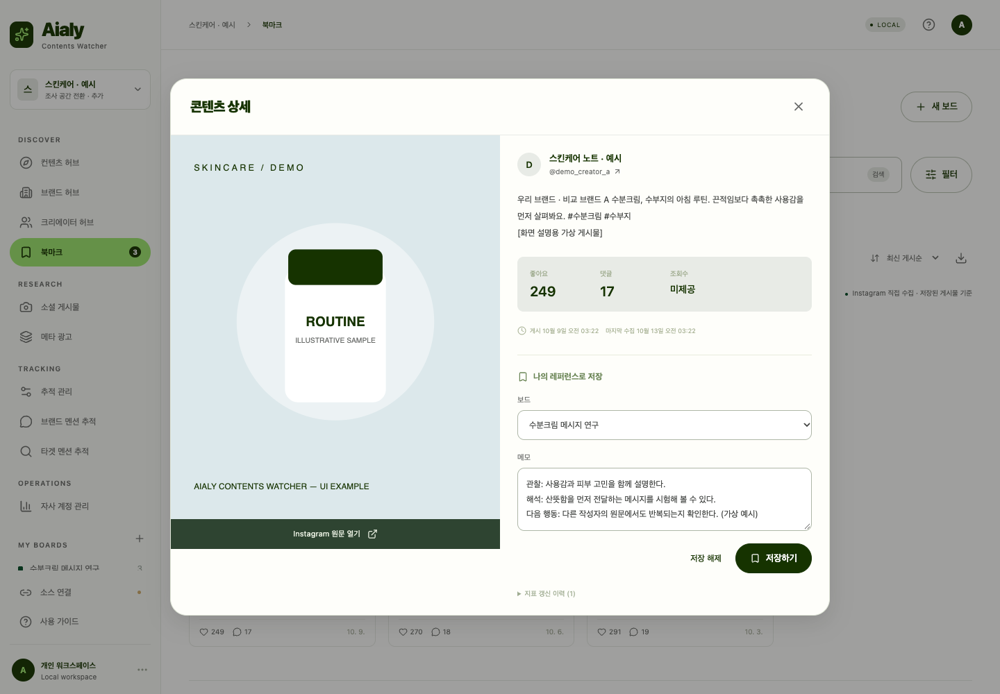

메모는 **관찰한 사실 → 해석 → 다음 행동** 순서로 적어 보세요. 원문 확인과 제공 지표를 통해 확인 가능한 사실과 추측을 구분합니다.

<a id="social"></a>

## 소셜 게시물

**언제 쓰나요?** 제품에서 소비자 표현으로 탐색을 확장할 때.

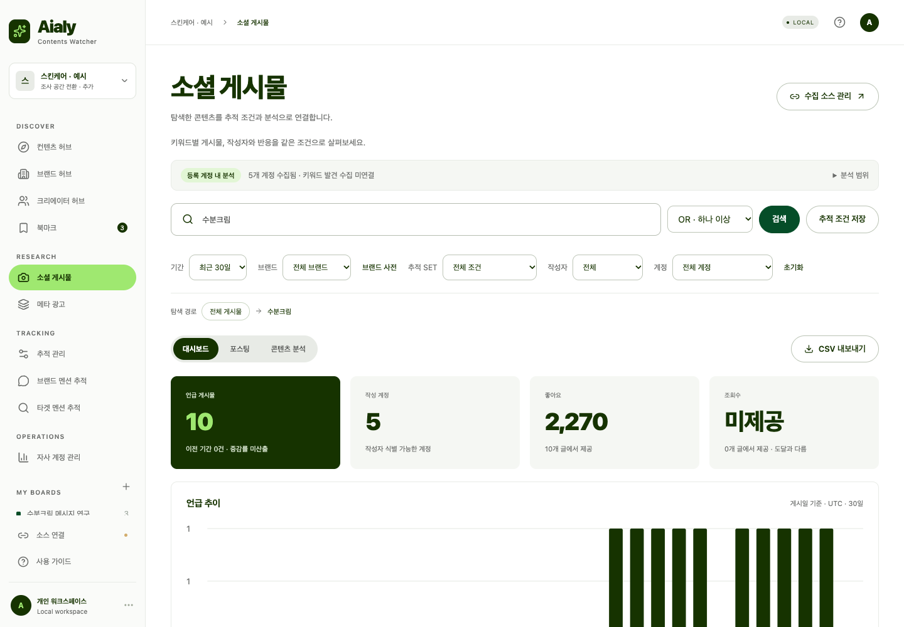

**사용 흐름:** 수분크림을 검색한 뒤 브랜드·연관 표현·작성자를 살펴봅니다. 수부지를 새 검색으로 열거나 작성자의 다른 표현을 보고 탐색 경로로 이전 조건에 돌아갑니다.

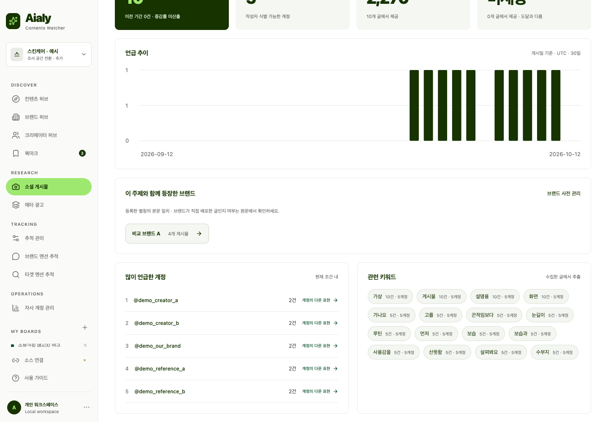

위 화면은 같은 대시보드를 아래로 스크롤한 모습입니다. 브랜드는 본문에 등장한 별칭을 기준으로 묶이고, 작성자와 관련 키워드를 눌러 탐색을 이어갑니다.

**알아두세요:** 게시물 증가와 반복 단어는 트렌드 후보입니다. 표본 크기·작성자 수·원문 맥락을 함께 확인하세요.

<a id="ads"></a>

## 메타 광고

**언제 쓰나요?** 어떤 문제와 카피로 제품을 소개하는지 비교할 때.

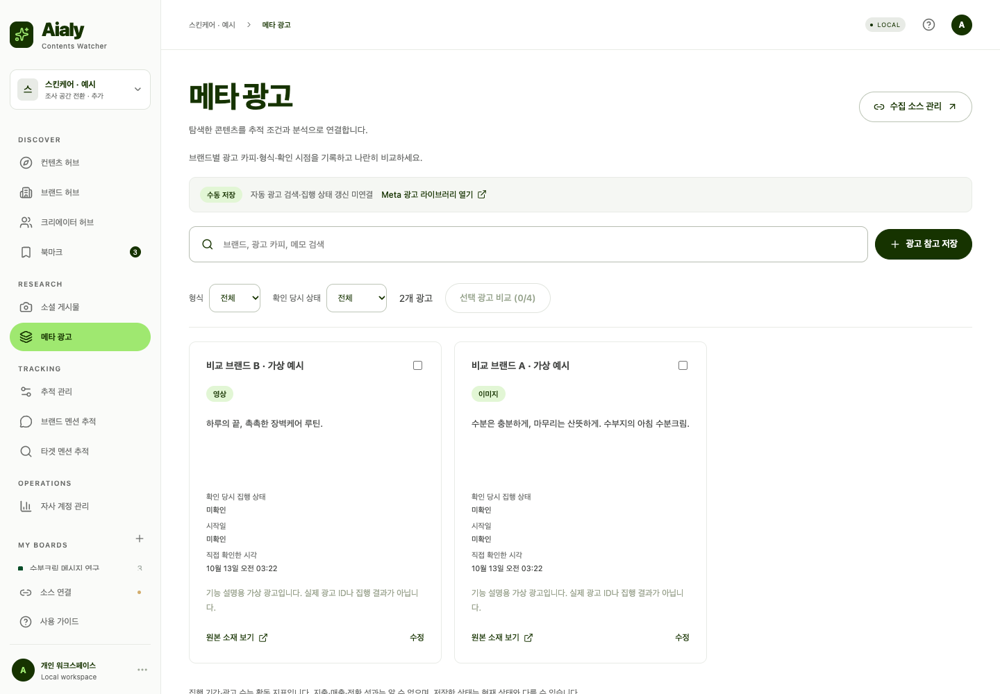

**사용 흐름:** 광고 라이브러리에서 확인한 링크, 브랜드, 카피, 형식, 상태와 메모를 직접 저장합니다. 검색·필터 후 광고를 선택해 비교합니다.

**알아두세요:** 자동 수집·집행 상태 갱신·광고비·전환·ROAS는 제공하지 않습니다. 화면의 광고 ID와 카피는 가상 예시입니다.

<a id="tracking"></a>

## 추적 관리

**언제 쓰나요?** 매주 반복해서 볼 질문을 저장할 때.

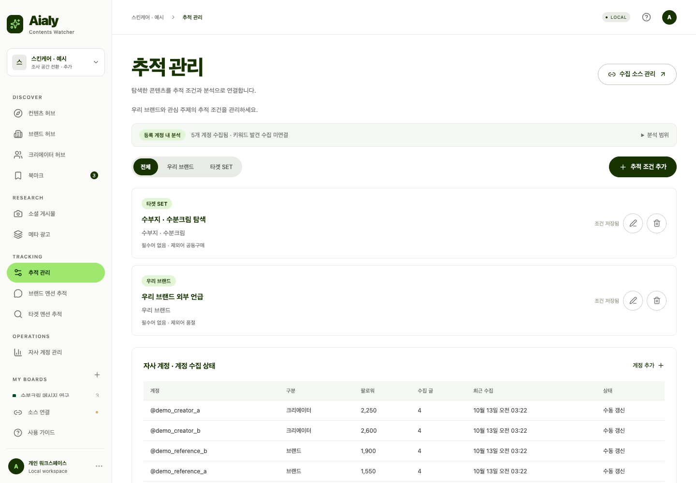

**사용 흐름:** 브랜드 또는 타겟 추적 조건에 포함 키워드·필수어·제외어·계정을 지정합니다. 예를 들어 수부지와 수분크림을 포함하고 공동구매를 제외하는 조건을 저장합니다.

**알아두세요:** 저장된 자료를 분류하는 조건입니다. 조건을 만드는 것만으로 새로운 계정 수집이 시작되지 않습니다.

<a id="brand-mentions"></a>

## 브랜드 멘션 추적

**언제 쓰나요?** 우리 브랜드를 외부 작성자가 어떻게 언급하는지 볼 때.

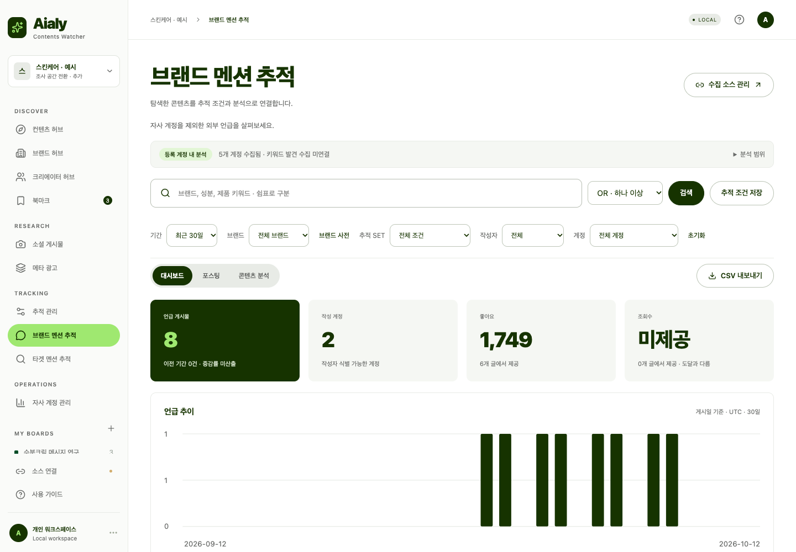

**사용 흐름:** 브랜드 추적 조건을 먼저 만든 뒤, 자사 게시물이 제외된 결과의 작성자·표현·기간별 변화를 봅니다. 중요한 게시물은 원문을 확인하고 북마크합니다.

**알아두세요:** 수집된 표본에서만 찾습니다. 자사 계정을 올바르게 분류해야 외부 언급 구분이 도움이 됩니다.

<a id="target-mentions"></a>

## 타겟 멘션 추적

**언제 쓰나요?** 수부지·장벽케어 같은 주제를 지속 관찰할 때.

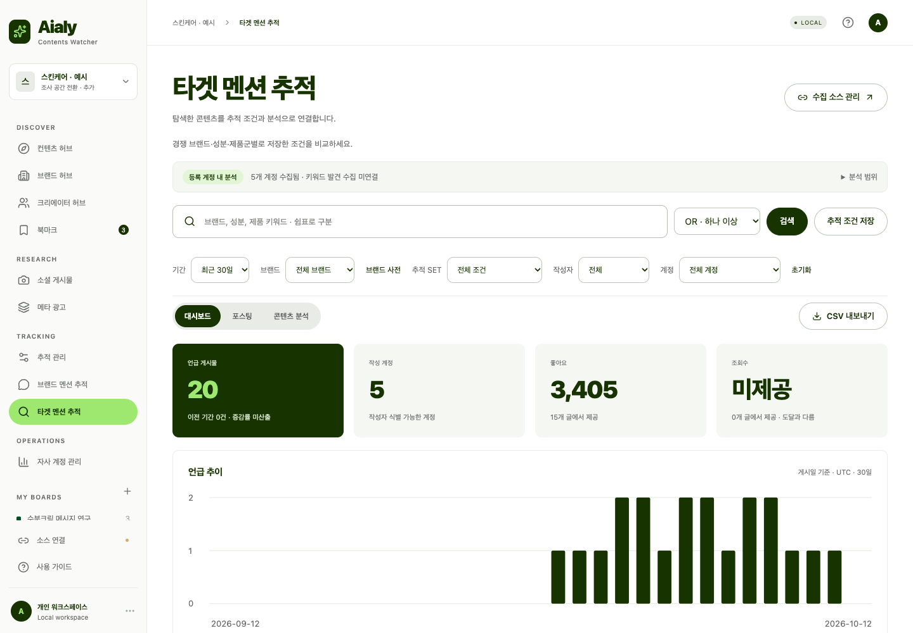

**사용 흐름:** 저장한 타겟 조건을 선택하고 기간·계정 조건으로 좁혀 봅니다. 연관 표현과 작성자를 따라 다음 조사 키워드를 찾습니다.

**알아두세요:** 키워드 일치는 긍정·부정 감성 판정이나 제품 효능의 증명이 아닙니다.

<a id="owned"></a>

## 자사 계정 관리

**언제 쓰나요?** 우리 계정이 어떤 콘텐츠를 발행했는지 돌아볼 때.

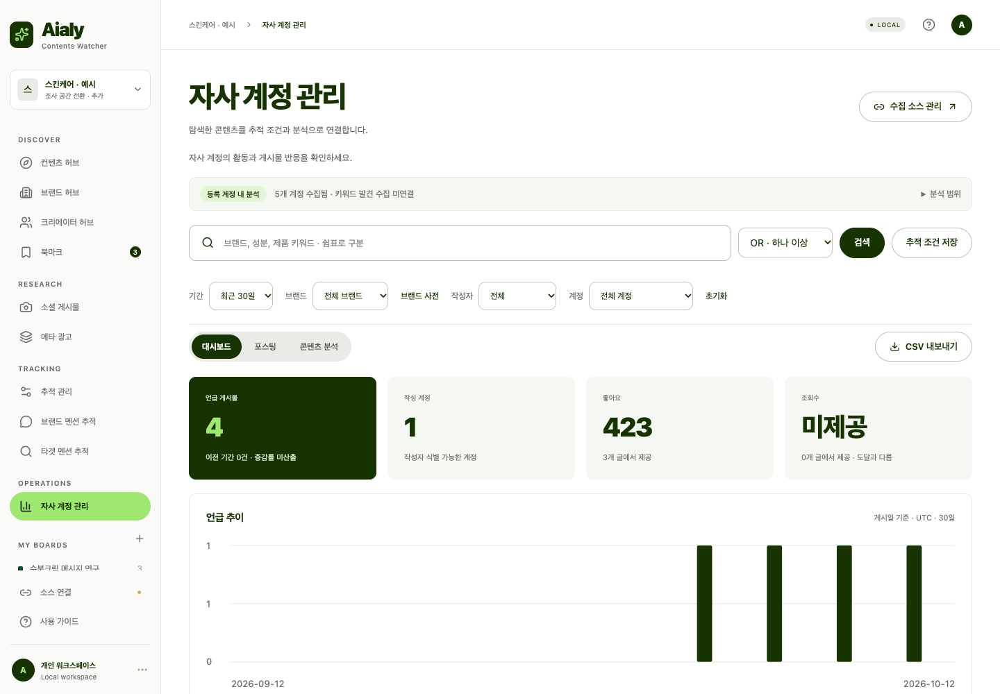

**사용 흐름:** 자사로 등록한 계정의 게시물·작성자·공개 반응 지표와 콘텐츠 분석을 확인합니다. 외부 언급 결과와 나란히 보며 우리가 전달한 메시지와 외부 표현을 비교합니다.

**알아두세요:** 공개 게시물 기준입니다. 도달·저장·매출 같은 비공개 인사이트는 아직 연결되지 않았습니다.

<a id="sources"></a>

## 소스 연결

**언제 쓰나요?** 실제 탐색을 시작하기 위한 수집 대상을 준비할 때.

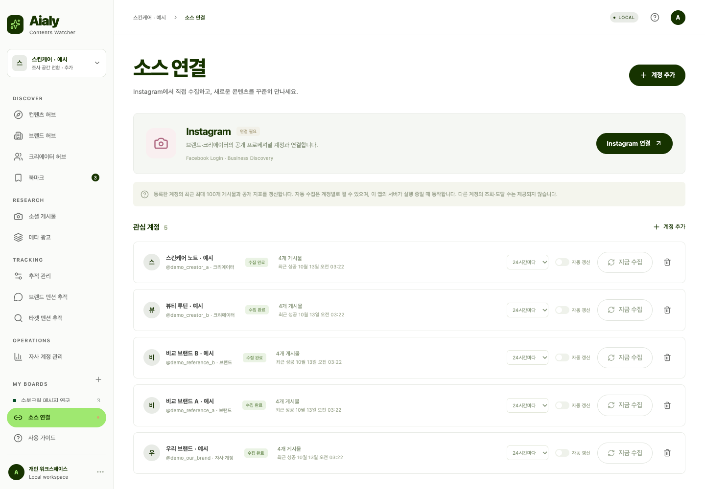

**사용 흐름:** 워크스페이스별 Instagram 연결을 설정하고 자사·브랜드·크리에이터 계정을 추가합니다. 지금 수집, 주기 설정, 수집 상태 확인, 계정 삭제를 관리합니다.

**알아두세요:** 예시 화면은 토큰 없이 준비했으므로 미연결 상태가 정상입니다. 실제 연결 방법은 Meta 설정 가이드를 참고하세요. 자동 수집은 명시적으로 켜야 하며 로컬 서버가 실행 중이어야 합니다.

<a id="workspaces"></a>

## 워크스페이스

**언제 쓰나요?** 스킨케어·바디케어·헤어케어 조사를 나누고 싶을 때.

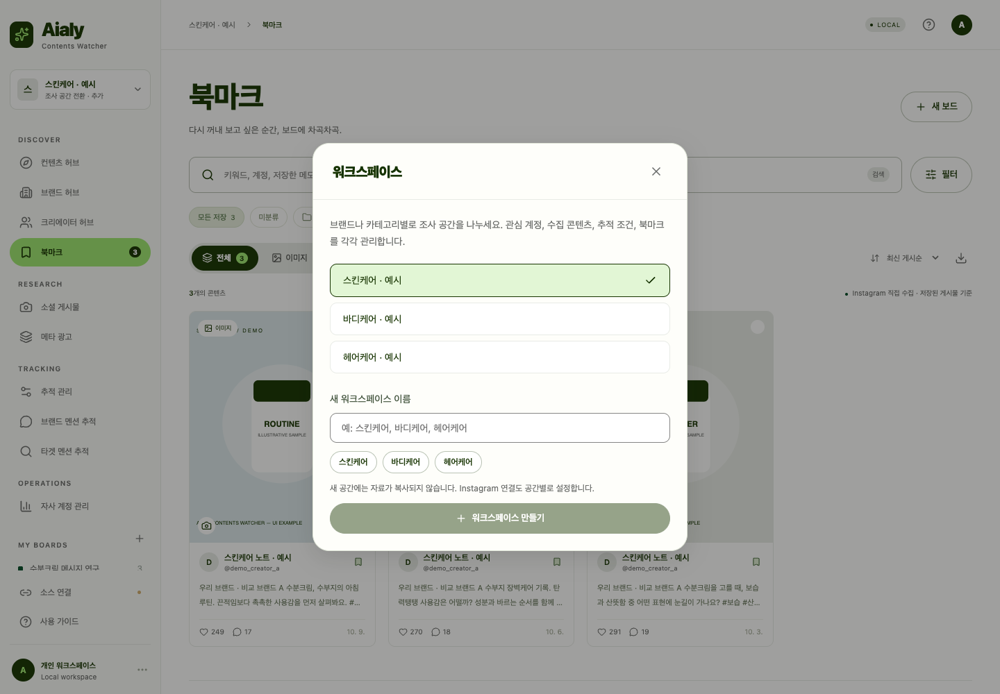

**사용 흐름:** 왼쪽 위 공간 이름을 눌러 기존 공간을 전환하거나 새 공간을 만듭니다. 브랜드·카테고리·국가·조사 목적에 맞춰 이름을 정할 수 있습니다.

**알아두세요:** 콘텐츠·계정·조건·북마크·연결 정보가 공간별로 분리됩니다. 팀 초대나 사용자별 접근 권한 기능은 아닙니다.

## 화면을 다시 만드는 방법

앱 UI가 바뀌면 저장된 이미지를 직접 수정하는 대신 현재 앱에서 다시 촬영합니다.

```sh
npm ci
npm run build
node scripts/capture-ui.mjs
```

기본 브라우저는 macOS의 Google Chrome입니다. 다른 환경에서는 `CHROME_PATH`를 지정하거나 `npx playwright install chromium` 후 `PLAYWRIGHT_BUNDLED_CHROMIUM=1 node scripts/capture-ui.mjs`를 실행하세요.

스크립트는 임시 디렉터리에 가상 자료를 만들고 임의의 로컬 포트에서 앱을 실행합니다. 실제 운영 데이터와 토큰을 읽지 않고 외부 브라우저 요청을 차단합니다. 수집 스케줄러를 시작하지 않으며 촬영이 끝나면 임시 DB와 서버를 정리합니다. 게시일은 촬영일에 맞춰 생성되므로 재촬영 날짜에 따라 날짜 표시와 기간 그래프는 달라집니다.

화면 파일은 `docs/screenshots/`, 생성 코드는 [`scripts/capture-ui.mjs`](../scripts/capture-ui.mjs)에 있습니다. 기능 범위는 현재 구현 기준이며 촬영용으로 UI 요소를 추가하거나 수정하지 않았습니다.
